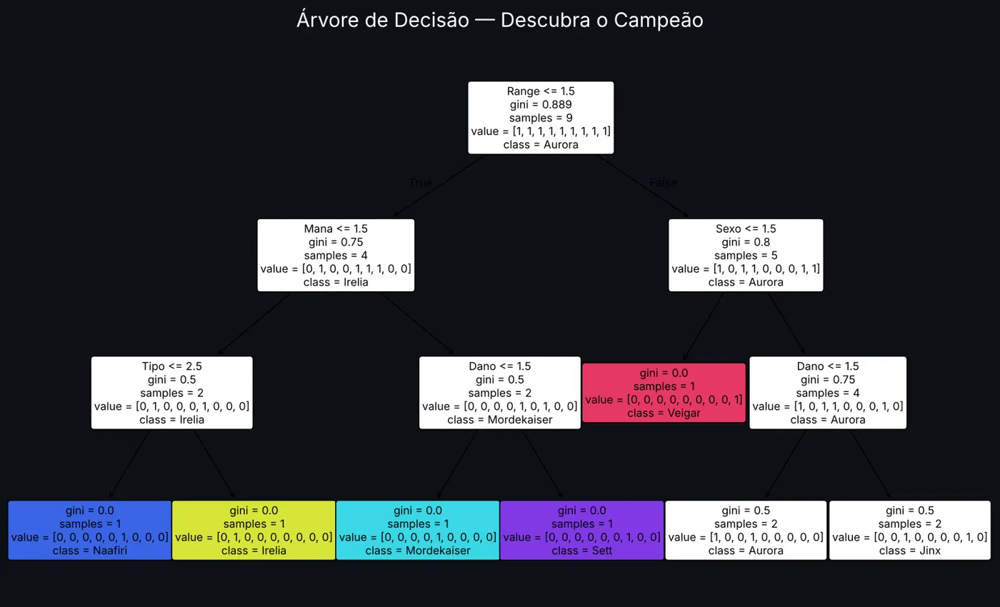
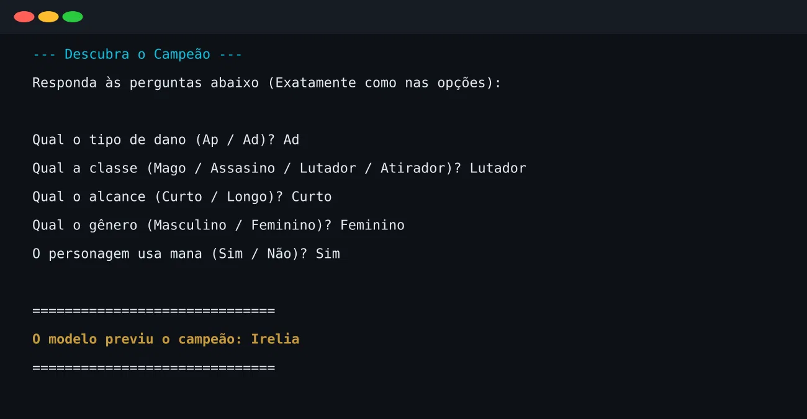

<!-- BANNER -->
<p align="center">

</p>

<!-- TYPING -->
<p align="center">
  
</p>

<!-- BADGES -->
<p align="center">
  
  
  
  
</p>

---

<h2 align="center">✦ Sobre o projeto</h2>

<p align="center">
Um mini <b>"Akinator" de League of Legends</b> feito com <b>Machine Learning</b>. <br>
O usuário responde a <b>5 perguntas</b> sobre um campeão no console <br>
e um modelo de <b>Árvore de Decisão</b> tenta adivinhar quem é. <br><br>
O objetivo foi praticar, de ponta a ponta, o fluxo básico de um projeto de ML: <br>
<b>carregar dados → transformar → treinar → prever</b>.
</p>

---

<h2 align="center">✦ Como funciona</h2>

<table align="center">
  <tr>
    <td align="center" width="25%">
      <h3>📊 Dados</h3>
      Planilha <code>Campeoes.xlsx</code> <br>
      com 9 campeões <br>
      e 5 características
    </td>
    <td align="center" width="25%">
      <h3>🔢 Transformação</h3>
      Textos convertidos <br>
      em números para <br>
      o modelo entender
    </td>
    <td align="center" width="25%">
      <h3>🌳 Treinamento</h3>
      <code>DecisionTreeClassifier</code> <br>
      aprende as regras <br>
      que separam cada campeão
    </td>
    <td align="center" width="25%">
      <h3>🎯 Previsão</h3>
      O usuário responde <br>
      no console e o modelo <br>
      revela o campeão
    </td>
  </tr>
</table>

---

<h2 align="center">✦ Base de dados</h2>

<p align="center">
Cada campeão é descrito por 5 características (<i>features</i>), e o <b>Nome</b> é o alvo (<i>target</i>):
</p>

<div align="center">

| Dano | Tipo | Range | Sexo | Mana | **Nome** |
|:---:|:---:|:---:|:---:|:---:|:---:|
| Ap | Mago | Curto | Masculino | Não | **Mordekaiser** |
| Ad | Assasino | Curto | Feminino | Sim | **Naafiri** |
| Ad | Lutador | Curto | Feminino | Sim | **Irelia** |
| Ad | Lutador | Curto | Masculino | Não | **Sett** |
| Ad | Atirador | Longo | Feminino | Sim | **Jinx** |
| Ad | Atirador | Longo | Feminino | Sim | **Tristana** |
| Ap | Mago | Longo | Masculino | Sim | **Veigar** |
| Ap | Mago | Longo | Feminino | Sim | **Aurora** |
| Ap | Mago | Longo | Feminino | Sim | **Kayle** |

</div>

<p align="center">
<b>Codificação usada:</b> <br>
<code>Ap=1 · Ad=2</code> &nbsp;|&nbsp;
<code>Mago=1 · Assasino=2 · Lutador=3 · Atirador=4</code> <br>
<code>Curto=1 · Longo=2</code> &nbsp;|&nbsp;
<code>Masculino=1 · Feminino=2</code> &nbsp;|&nbsp;
<code>Sim=1 · Não=2</code>
</p>

---

<h2 align="center">✦ A árvore do modelo</h2>

<p align="center">
Visualização das regras que o modelo aprendeu. <br>
A primeira pergunta que ele "faz" é sobre o <b>alcance</b>, a que mais divide os campeões.
</p>

<p align="center">
  
</p>

---

<h2 align="center">✦ Preview</h2>

<p align="center">
  
</p>

---

<h2 align="center">✦ Como executar</h2>

```bash
# 1. Clone o repositório
git clone https://github.com/LucScomparin/Akinator-LOL.git
cd Akinator-LOL

# 2. Instale as dependências (pandas, scikit-learn e openpyxl)
pip install -r requirements.txt

# 3. Rode o script (ou abra no Jupyter / VS Code)
python campeoes.py
```

<p align="center">
<i>Responda às perguntas exatamente como nas opções exibidas.</i>
</p>

---

<h2 align="center">✦ Destaques</h2>

<p align="center">
✅ Fluxo completo de Machine Learning em poucas linhas <br>
✅ Dados reais organizados em planilha Excel <br>
✅ Interação direta com o usuário pelo console <br>
✅ Modelo interpretável: dá para ver cada decisão da árvore
</p>

---

<h2 align="center">✦ Próximos passos</h2>

<p align="center">
🔹 Adicionar mais campeões e características (rota, região, ano de lançamento…) <br>
🔹 Desempatar campeões idênticos na base — hoje <b>Jinx/Tristana</b> e <b>Aurora/Kayle</b> têm as mesmas respostas <br>
🔹 Validar as respostas do usuário em vez de usar valores padrão <br>
🔹 Criar uma interface gráfica ou web para o jogo
</p>

---

<h2 align="center">✦ Sobre mim</h2>

<p align="center">
Sou <b>Lucas Gabriel Scomparin Campos da Cruz</b>, estudante de <b>Analise e Desenvolvimento de Sistemas</b>. <br>
Este projeto faz parte dos meus estudos em <b>Python e Machine Learning</b>.
</p>

<p align="center">
<a href="mailto:lucasscomparin17@gmail.com">
  
</a>
<a href="https://linkedin.com/in/lucasscomparin">
  
</a>
<a href="https://github.com/Luczin10">
  
</a>
</p>

---

<p align="center">
✦ <i>Projeto desenvolvido por Lucas Scomparin — 2026</i>
</p>

<p align="center">
  
</p>
